# 手机拍一段视频，在自己电脑上生成三维模型：MILo Studio 一键整合包上手指南

> 绕着物体拍 20 秒视频，双击一个启动脚本，在浏览器里点几下，最后得到一个可以直接拖进 Blender 的带颜色三维模型。整个过程都在你自己的电脑上完成，不用上传云端，也不用写一行代码。

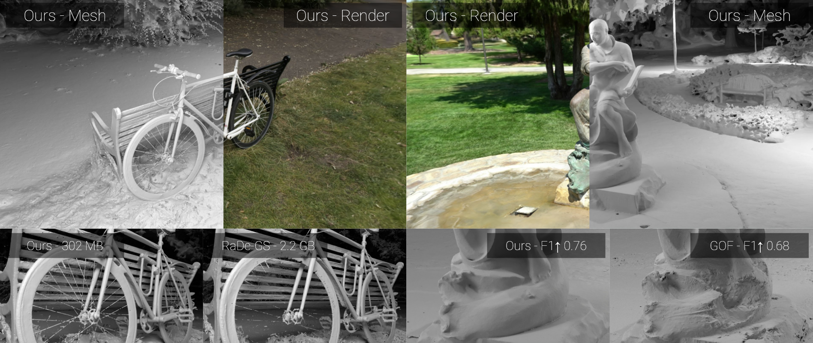

*图：MILo 论文中的重建效果（图片来自原项目）*

---

## 一、MILo 是什么

**MILo**（Mesh-In-the-Loop Gaussian Splatting）是一种**从多张照片重建三维网格**的方法，来自巴黎综合理工学院（École polytechnique）和法国国家信息与自动化研究所（Inria）的研究团队，论文发表在 **SIGGRAPH Asia 2025**（期刊版 ACM TOG）。

原项目只提供了 Linux 下的命令行用法，安装需要自己编译好几个 CUDA 模块，对普通用户门槛很高。为此我在原项目基础上做了一个分支版本：

- **项目地址：https://github.com/Langjudy/MILo**
- **新增 Windows 原生支持**：修复了只能在 Linux 下编译的模块，不需要 WSL 或虚拟机
- **新增 MILo Studio**：一个本地网页界面，把视频抽帧、相机位姿估计、训练、预览、网格导出串成四个步骤，每一步都有实时进度条
- **新增一键整合包**：Python 环境、编译好的 CUDA 模块、COLMAP、模型权重全部打包在一起，**解压后双击 `start.bat` 就能用**，不需要安装 Python、CUDA 或 Visual Studio

## 二、它能做什么

输入：**一段绕物体拍摄的视频，或者一组多角度照片**。

输出：

1. **可以实时浏览的三维场景**（3D 高斯泼溅，画面接近照片级）
2. **带颜色的三角网格模型**，支持 PLY / OBJ / GLB / STL 格式，可以直接导入 Blender、Unity、Unreal、3ds Max，也可以拿去 3D 打印

适合的场景：

- 文物、手办、雕塑、乐器等**物体数字化**
- 为游戏、影视、电商**快速制作三维素材**
- 室内外场景的**数字孪生、留档**
- 学习和研究**三维重建 / 高斯泼溅**技术

---

## 三、它是怎么工作的

### 1. 整体流程

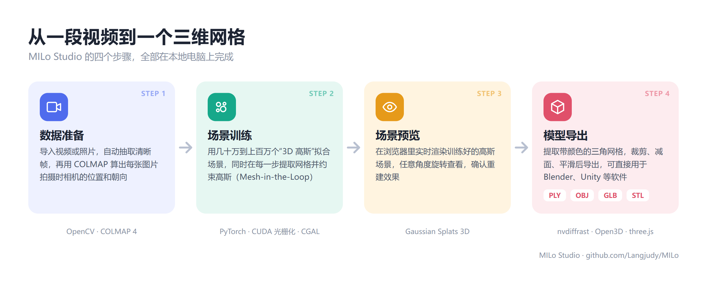

整个过程分四步，MILo Studio 的界面也是按这四步组织的：

1. **数据准备**：从视频里抽取清晰的帧，再用 **COLMAP** 算出每张图片拍摄时相机的位置和朝向（这一步叫“运动恢复结构”，SfM）。
2. **场景训练**：用几十万到上百万个 **3D 高斯**（可以理解为带颜色、半透明的小椭球）去拟合场景，让它们从每个相机角度渲染出来都和照片一样。
3. **场景预览**：在浏览器里实时渲染训练结果，任意角度查看。
4. **模型导出**：从高斯中提取三角网格，经过裁剪、平滑、减面后导出。

### 2. MILo 的关键创新：Mesh-in-the-Loop

3D 高斯泼溅（3DGS）这两年非常火，渲染效果好、速度快。但它有一个问题：**高斯只为“画面好看”而优化，并不一定贴合物体的真实表面**。传统做法是训练完以后，再用 TSDF、Marching Cubes 等方法从中“抠”出网格，结果往往满是噪点和漂浮碎片，顶点数还特别多。

MILo 的思路是：**不要等训练完再提取网格，而是在训练的每一步都提取一次网格，并让网格参与优化。**

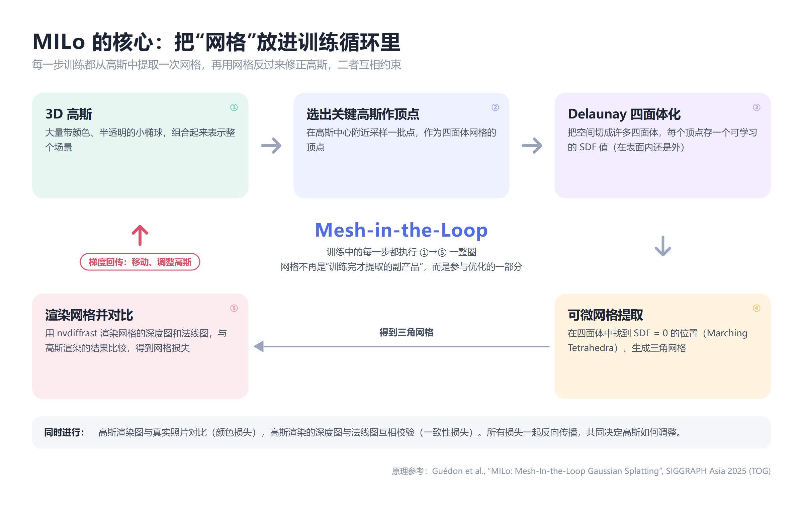

具体来说，每一步训练都会：

1. 从高斯中选出一批关键点，作为顶点做 **Delaunay 四面体化**，把空间切成许多小四面体；
2. 每个顶点保存一个可学习的 **SDF 值**，表示它在物体表面的内侧还是外侧；
3. 用**可微的 Marching Tetrahedra** 找到 SDF = 0 的位置，得到三角网格；
4. 用 **nvdiffrast** 渲染这个网格的深度图和法线图，要求它们和高斯渲染的结果一致；
5. 误差的梯度**回传给高斯**，把高斯“拉”到真实表面上。

这样训练结束时，网格和高斯已经高度吻合。论文给出的结论是：**在同等质量下，网格顶点数比现有方法少一个数量级。**

### 3. 训练中实际看到的样子

下面是我用一段 21 秒的小提琴视频训练时，界面里自动保存的“训练快照”。上排是 3D 高斯渲染的彩色图、深度图和法线图，下排是同一时刻从高斯中提取出的**网格**渲染的同样三张图。可以看到，下排网格的深度和法线已经和上排的高斯高度一致，这正是 Mesh-in-the-Loop 起作用的表现。

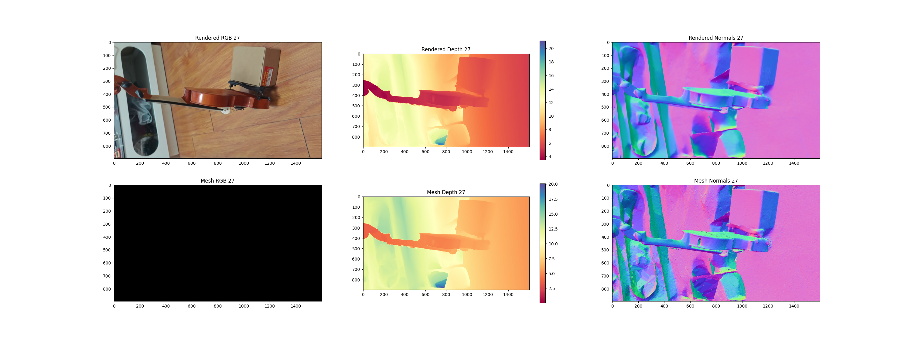

---

## 四、本地部署：一键整合包

### 1. 电脑要求

| 项目 | 要求 |
|---|---|
| 系统 | Windows 10 / 11（64 位） |
| 显卡 | NVIDIA RTX 20 / 30 / 40 系列，**显存 8GB 以上**，推荐 12GB 以上 |
| 显卡驱动 | **528 或更高版本**（在 NVIDIA 官网或 GeForce Experience 中更新） |
| 硬盘 | 解压后约 8GB，每个项目再额外占用 1–3GB |
| 其他 | **不需要**安装 Python、CUDA、Visual Studio，全部已打包 |

> 整合包里的 CUDA 模块已针对 RTX 20 / 30 / 40 系列（以及 A100、H100）分别预编译，并在 RTX 4060 Ti 16GB 上完成了完整测试。暂不支持 RTX 50 系列（整合包内的 PyTorch 版本还不支持该架构）和 AMD / Intel 显卡。

### 2. 下载与解压

1. 下载整合包 `MILo-Studio-win64.zip`：**【网盘链接待补充】**
2. 解压到一个**纯英文、不含空格**的路径，例如 `D:\MILo-Studio-win64`。**不要放在带中文或空格的文件夹里**（比如中文用户名下的“桌面”），COLMAP 和训练脚本对这类路径支持不好。启动时如果检测到路径有问题，窗口里会给出警告。

解压后的文件夹大致是这样：

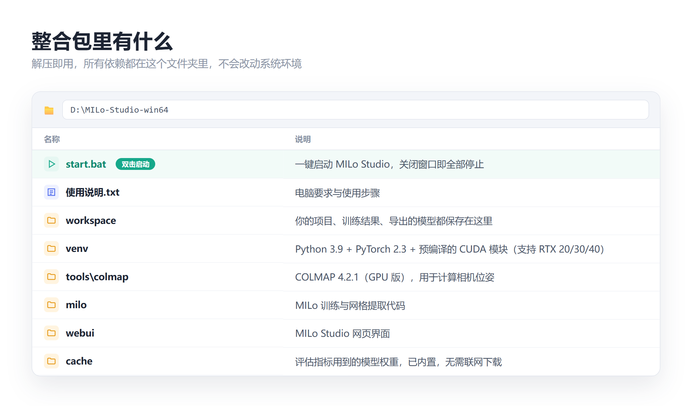

### 3. 一键启动

**双击 `start.bat`**。会弹出一个黑色命令行窗口，几秒钟后浏览器会自动打开 `http://127.0.0.1:7860`。

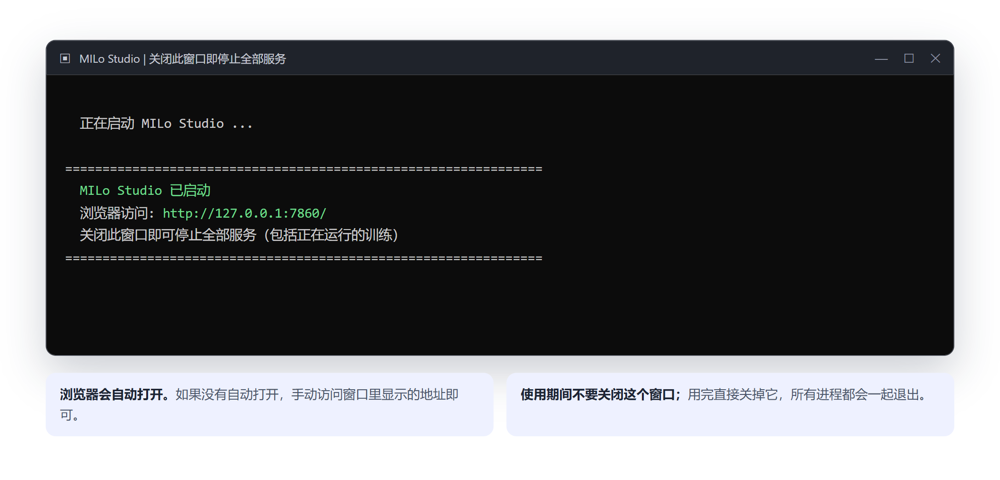

几点说明：

- 这个黑色窗口就是 MILo Studio 的后台，**使用期间不要关闭它**；
- **想退出时，直接关掉这个黑色窗口**，所有服务和正在运行的训练会一起停止，不会在后台残留进程；
- 如果启动时出现“警告”字样（比如路径有中文、驱动版本过旧），按提示处理后重新启动即可。

---

## 五、使用教程：从视频到三维模型（重点）

下面用我拍的一段**小提琴视频**（手机拍摄，21 秒，1080p）完整演示一遍。

### 第 0 步：拍摄建议

拍得好，后面就成功了一半：

- **绕着物体缓慢走一圈**，最好高、低角度各拍一圈；
- 保持画面清晰，**移动要慢**，避免运动模糊；
- 光照均匀稳定，避免强烈的反光和阴影变化；
- 物体在画面中**尽量占较大比例**；
- 尽量避开**透明、镜面、纯色无纹理**的物体（这类物体对所有三维重建方法都是难题）。

### 第 1 步：新建项目

打开页面后，点击右上角的 **“新建项目”**，输入项目名称，选择素材类型：

- **视频**：绕物体拍摄的视频，系统会自动抽帧；
- **图片**：一组多角度照片（建议 50–300 张）；
- **已有数据集**：如果你已经有 COLMAP 格式的数据（包含 `images/` 和 `sparse/0/`），可以直接导入，跳过数据准备。

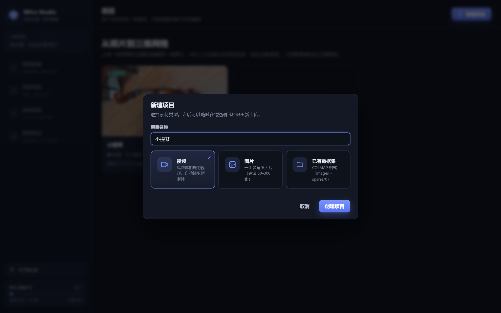

### 第 2 步：上传视频，设置抽帧

进入“**数据准备**”页面，把视频**拖进上传框**。上传完成后会自动显示视频的时长、帧率、分辨率和总帧数。

右侧是处理参数：

- **抽帧方式**：推荐“**按每秒帧数**”。比如设为 4 帧/秒，21 秒的视频就会抽出约 85 帧。视频被等分成若干小段，**每段挑最清晰的一帧**，保证视频的每一秒都有画面；
- **图片最长边**：默认 1600 像素即可，更大只会拖慢速度；
- **特征匹配方式**：保持“**自动**”。300 张以内会两两比较所有图片，最不容易“断片”。

页面上方会实时提示“将抽取多少帧、每秒几帧、是否覆盖每一秒”。确认后点击 **“开始处理”**。

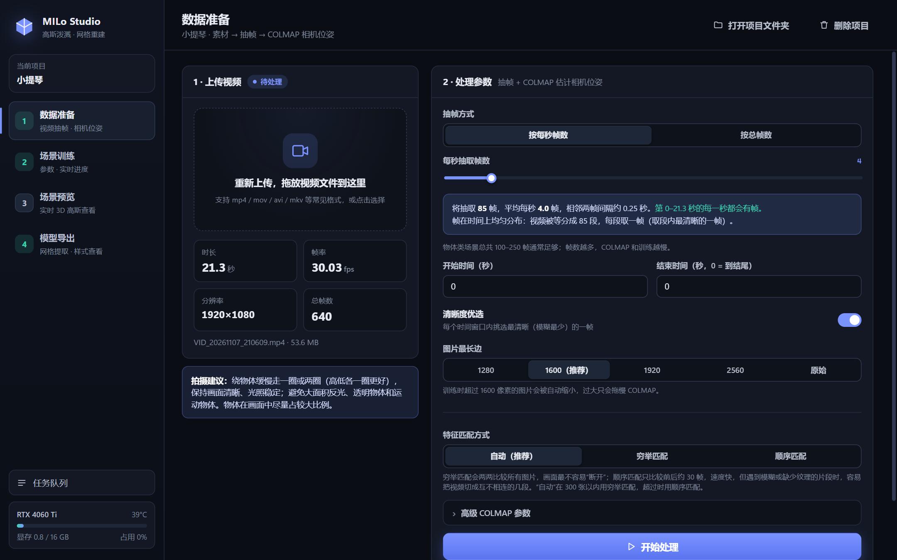

### 第 3 步：等待相机位姿计算完成

处理分五个阶段：**视频抽帧 → 特征提取 → 特征匹配 → 稀疏重建 → 图像去畸变**。每个阶段都有独立的进度条，右侧会实时显示抽出的图片。

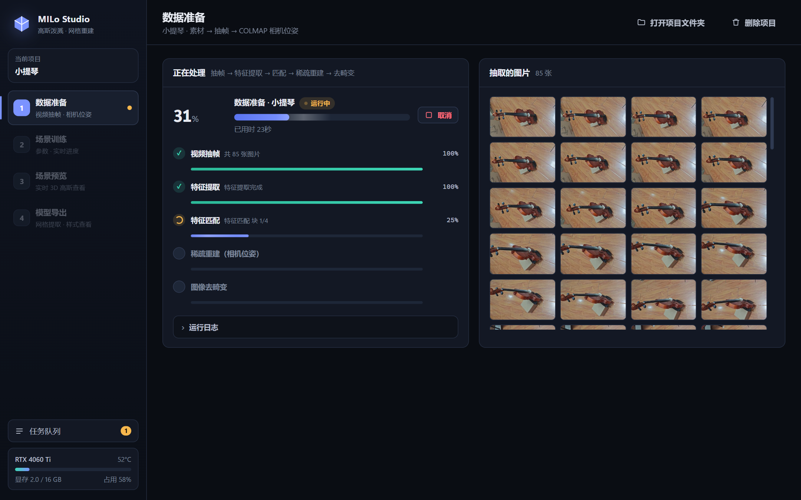

完成后会显示数据集概况。重点看“**时间覆盖**”图：每一根柱子代表视频中的一秒，**绿色表示这一秒的画面成功进入了重建**，红色表示 COLMAP 没能算出这些帧的相机位置。全部是绿色就可以放心进入下一步。

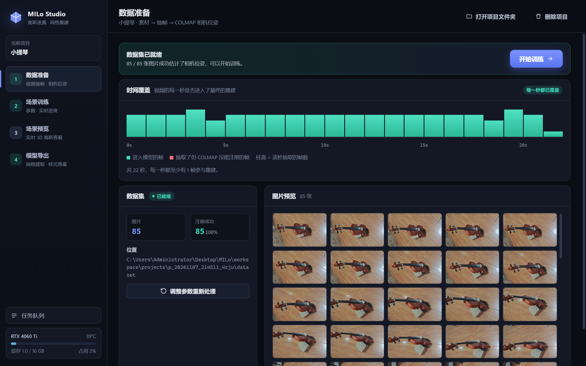

> 如果出现红色，说明那几秒的画面可能太模糊或缺少纹理。可以点“调整参数重新处理”，提高每秒帧数，或者重新拍摄那一段。

### 第 4 步：设置训练参数

进入“**场景训练**”页面，左侧是训练参数，最上方有四个**质量预设**：

| 预设 | 特点 | 参考耗时* |
|---|---|---|
| 快速预览 | 最快出结果，网格较粗，适合先试拍得行不行 | 约 25–35 分钟 |
| 标准 | 官方默认配置，速度与质量均衡 | 约 30–50 分钟 |
| **高质量** | 稠密高斯 + 外观解耦，细节更好 | 约 1–1.5 小时 |
| 极致 | 最高网格分辨率，显存需求最大 | 约 1.5–2.5 小时 |

*\*以 RTX 4060 Ti 为准，实际取决于图片数量和场景复杂度。*

另外两个常用选项：

- **场景类型**：拍摄的是室内房间选“室内”，绕着单个物体拍摄或户外场景选“室外 / 物体环绕”；
- **外观解耦**：不同照片之间亮度、白平衡差异较大时（比如手机自动曝光）建议打开。

其余参数都放在“**高级参数**”里，每一项都有中文说明，一般不需要改。点击 **“开始训练”**。

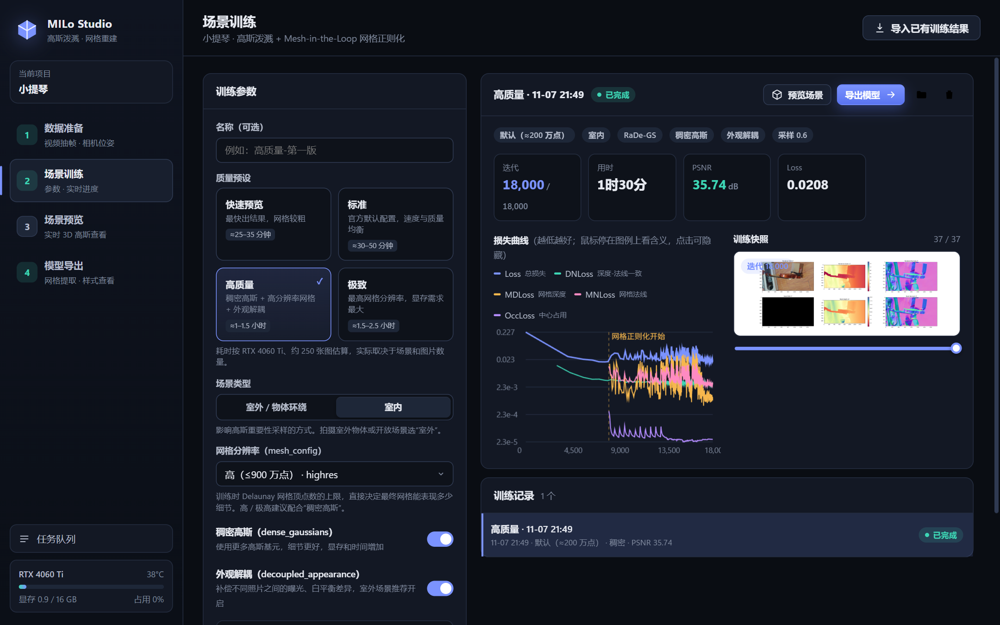

### 第 5 步：实时查看训练进度

训练开始后，右侧会实时显示：

- **整体进度和各阶段进度**：加载数据 → 高斯优化与致密化 → 网格正则化（Mesh-in-the-Loop）→ 评估与保存；
- **迭代 / 速度 / 剩余时间**：总共 18,000 步。前 8,000 步是普通的高斯训练，之后开始“网格正则化”，速度会变慢，这是正常的；
- **损失曲线**：数值越低越好。Loss 是渲染图和照片的差距；DNLoss 是深度和法线的一致性；进入网格正则化阶段后，还会出现网格相关的损失（鼠标停在图例上可以看到每一项的含义）；
- **训练快照**：每 500 步保存一张对比图，拖动下方滑块可以回看训练过程。

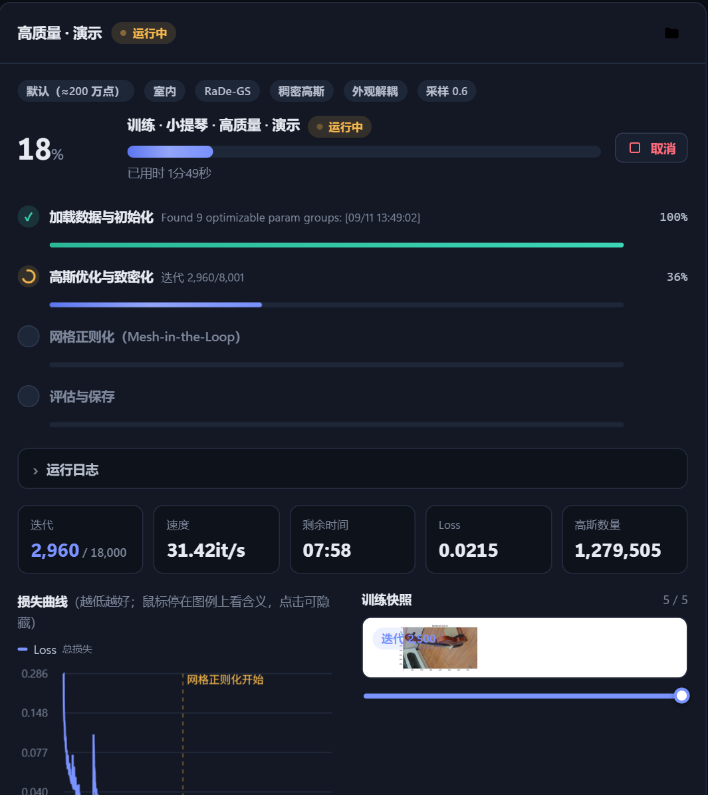

训练完成后会显示最终的 **PSNR**（数值越高说明渲染画面越接近照片，一般 25 以上就不错，30 以上就很好）。我这段小提琴视频用“高质量”预设训练了约 91 分钟，**PSNR 达到 35.7**。

### 第 6 步：实时预览三维场景

进入“**场景预览**”页面，浏览器会直接加载并实时渲染训练好的三维场景：

- **左键拖动旋转，右键拖动平移，滚轮缩放**；
- 拖动“**跳转到训练相机**”滑块，可以切换到任意一张原始照片的拍摄角度；
- 点击“**保存截图**”可以把当前画面存成图片；
- 如果训练过多个版本，可以点“**设为默认模型**”，导出时会自动选用它。

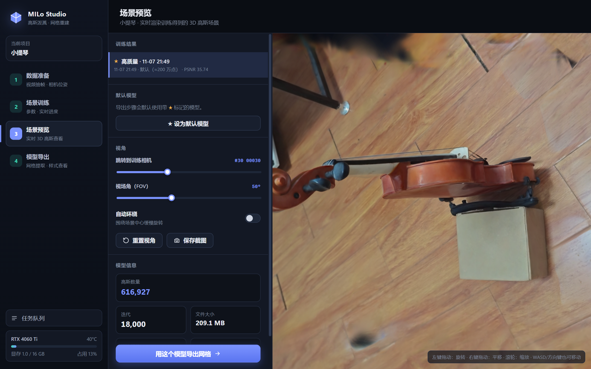

### 第 7 步：导出三维网格

进入“**模型导出**”页面。左侧是导出设置，从上到下依次是：

1. **网格提取方法**：推荐默认的“**SDF 精细化**”（MILo 原生方法，细节最好）；
2. **自动裁剪**：只保留相机围绕的主体区域，去掉远处背景和天空中的碎片。**强烈建议开启**，否则模型里会混入大量远处背景；
3. **坐标系**：导入 Blender、3ds Max、UE 选“**Z 轴朝上**”，导入 Unity、Maya 选“Y 轴朝上”；
4. **去除小碎片 / 表面平滑 / 减面**：按需调整，减面可以把几百万面的模型压到几十万面，方便在其他软件里使用；
5. **输出格式**：PLY、OBJ、GLB、STL 可多选。

点击 **“开始导出”** 后，下方会分两组显示进度：“**预处理与网格提取**”和“**后处理与导出**”。

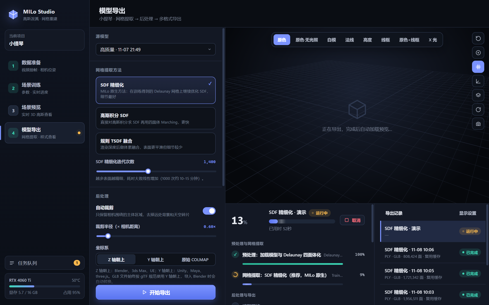

> 第一次导出需要从训练结果中提取原始网格，大约 5–10 分钟。之后如果只是修改裁剪范围、坐标系、减面等后处理参数，会**复用已经提取好的网格**，几十秒就能完成。

### 第 8 步：在线查看模型效果并下载

导出完成后，模型会直接加载到右侧的 3D 查看器里。顶部工具栏可以切换多种显示样式：

- **原色**：带光照的真实颜色；
- **白模**：只看几何形状，最能看出表面质量；
- **法线**：用颜色表示表面朝向，便于检查表面是否平整；
- **高度 / 线框 / 原色+线框 / X 光**：便于检查模型结构和网格密度。

右侧还可以开关地面网格、坐标轴、平面着色和自动旋转，“显示设置”里可以切换光照、背景和曝光。

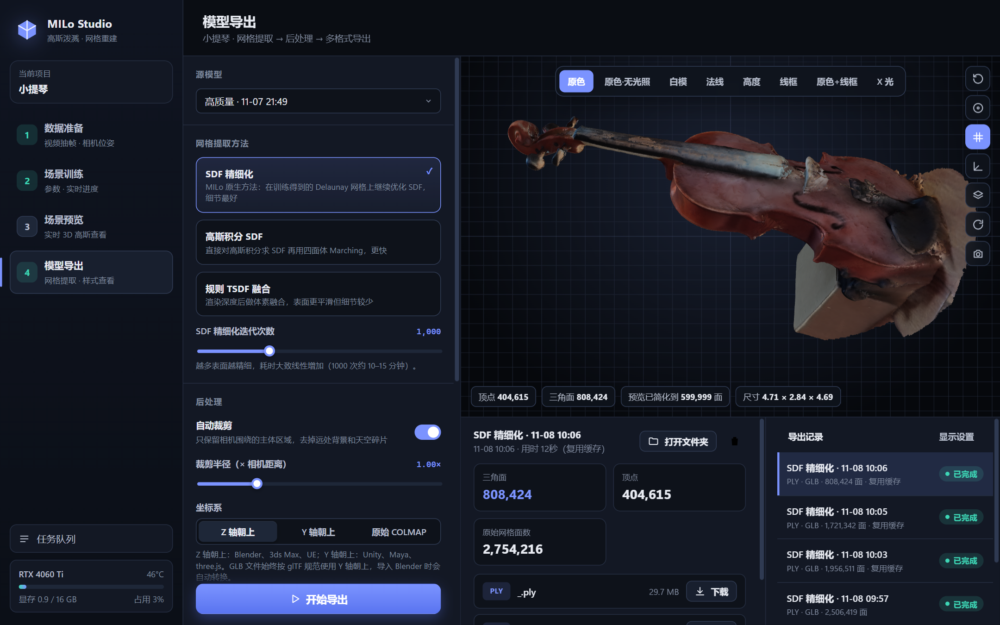

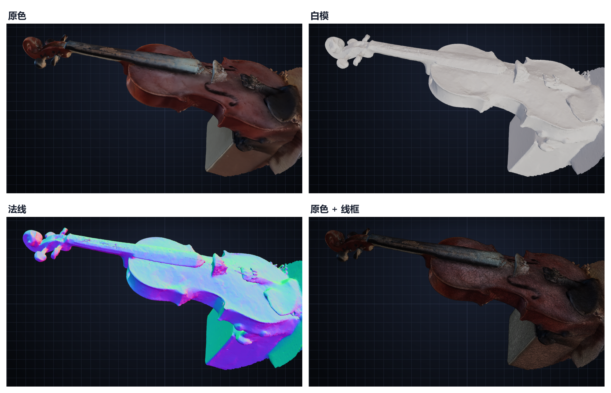

满意后，在下方文件列表中点击“**下载**”，或者点“**打开文件夹**”直接找到导出的文件。

---

## 六、常见问题

**Q：运行时需要联网或下载大模型吗？**
不需要。MILo 是针对每个场景**从零开始优化**的，不是生成式 AI，场景完全来自你拍的画面。整合包里已经包含 COLMAP 和评估用的权重文件，可以完全离线使用。

**Q：显存不够怎么办？**
选“快速预览”或“标准”预设；在高级参数里把“图片存放位置”改为“内存”，或者把“高斯采样系数”调小。

**Q：重建出来的模型缺了一块？**
先看“数据准备”页面的时间覆盖图有没有红色。红色的那几秒画面没有进入重建，可以提高每秒帧数后重新处理，或者补拍那个角度。

**Q：导入 Blender 后看到一堆碎片，找不到物体？**
导出时开启“自动裁剪”，坐标系选“Z 轴朝上”。在 Blender 里按小键盘的 `.` 可以快速聚焦到模型；想看颜色，把视图着色里的颜色改为“属性”。

**Q：模型表面不够平滑？**
优先选用“高质量”预设重新训练；导出时可以适当开启“表面平滑”（5–10 次）。也要说明的是，真实拍摄重建出的模型很难像手工建模那样完美光滑，透明、反光的部位尤其难处理。

---

## 七、写在最后

MILo 的价值在于，它让“从照片得到干净、轻量的网格”这件事变得更可靠；MILo Studio 则尽量把这件事的门槛降到“会拍视频、会点鼠标”就够了。欢迎大家下载试用，也欢迎在项目主页提 Issue 反馈问题。

- **本项目（Windows 版 + MILo Studio）**：https://github.com/Langjudy/MILo
- **原项目与论文**：https://anttwo.github.io/milo （Antoine Guédon、Diego Gomez 等，SIGGRAPH Asia 2025）

> **许可说明**：MILo 基于 Inria 的 3D Gaussian Splatting 代码开发，相关部分遵循 Gaussian-Splatting License，**仅限非商业的研究和评估用途**。如需商业使用，请联系原作者和 Inria 获取授权。整合包中包含的 COLMAP、nvdiffrast 等第三方组件遵循各自的开源许可。
